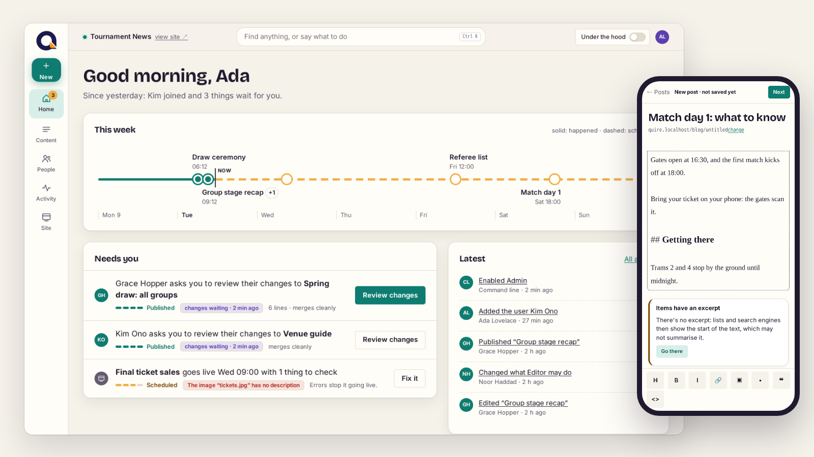

  <picture>
    <source media="(prefers-color-scheme: dark)" srcset="https://raw.githubusercontent.com/quirecms/.github/main/brand/quire-wordmark-white.png">
    
  </picture>

<strong>The extensible CMS for PHP, built on Symfony.</strong>

  <picture>
    <source media="(prefers-color-scheme: dark)" srcset="https://raw.githubusercontent.com/quirecms/.github/main/brand/quire-hero-dark.png">
    
  </picture>

Quire has a small core, and everything else is an extension with the same API, the admin included. You write content in Markdown, with revisions and reviews; PostgreSQL holds everything, with uploaded files on a volume or any S3-compatible service, so one backup holds your whole site. Quire runs on its own or inside an existing Symfony application, and Quire Server runs many Quire sites on one machine.

> **Status:** early development, no stable release yet (0.x). Content, URLs, extensions, themes, users and permissions, the admin in the browser and on phones, storage, backups, background jobs and the audit log work. Quire Server runs, updates, backs up and restores sites.

### Repositories

| Repository | What it is |
|------------|------------|
| [framework](https://github.com/quirecms/framework) | Quire itself, where all its packages are developed: the engine, the admin, the default theme, the testing kit and a ready-to-run Docker setup |
| [server](https://github.com/quirecms/server) | Quire Server: many Quire sites on one machine, with HTTPS, updates that roll back by themselves, and backups off the machine |

Read-only copies of the framework's packages, which Composer installs from (issues and pull requests go to [framework](https://github.com/quirecms/framework)):

| Repository | Package |
|------------|---------|
| [skeleton](https://github.com/quirecms/skeleton) | `quire/skeleton`, the starter project of new sites: `composer create-project quire/skeleton mysite` |
| [core](https://github.com/quirecms/core) | `quire/core`, the engine |
| [admin](https://github.com/quirecms/admin) | `quire/admin`, the admin interface |
| [theme-default](https://github.com/quirecms/theme-default) | `quire/theme-default`, the default theme (WCAG 2.2 AA, light and dark) |
| [testing](https://github.com/quirecms/testing) | `quire/testing`, for testing extensions and themes |

### Get involved

- **Try it:** the [quick start](https://github.com/quirecms/framework#quick-start) runs Quire with Docker in a few minutes.
- **Host sites:** [Quire Server](https://github.com/quirecms/server#installing-it) installs on an Ubuntu machine with one command.
- **Build on it:** write an [extension](https://github.com/quirecms/framework/blob/main/docs/extensions.md) or a [theme](https://github.com/quirecms/framework/blob/main/docs/themes.md).
- **Contribute:** read the [contributing guide](https://github.com/quirecms/framework/blob/main/CONTRIBUTING.md), and report bugs as issues of [the framework](https://github.com/quirecms/framework/issues) or [the server](https://github.com/quirecms/server/issues).
- **Security:** report vulnerabilities privately, as described in our [security policy](https://github.com/quirecms/.github/blob/main/SECURITY.md).

Quire is open source under the MIT license, made by [YorvoLabs](https://quirecms.com).
